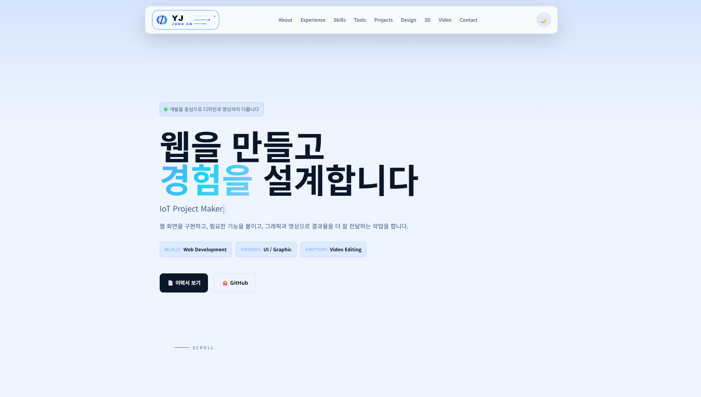

# 유종안 포트폴리오

웹 서비스, Windows 데스크톱 앱, IoT 프로젝트와 디자인·영상·3D 작업을 정리한 개인 포트폴리오입니다. 각 프로젝트의 상세 화면에서 제작 배경, 담당 역할, 구현 기능과 사용 기술을 확인할 수 있습니다.

[포트폴리오 사이트](https://portfolio-mauve-theta-54.vercel.app/) · [GitHub 프로필](https://github.com/ajttk369) · [이력서](resume.pdf)



## 사이트 구성

- **소개·실무 경험** · LMS 기능 개선과 유지보수, 서버 운영 지원, 학생 데이터 관리 경험
- **기술 스택** · 웹 화면 구현, 서버 API, 데이터베이스, 외부 API 연동
- **프로젝트** · 대표 프로젝트 4개와 추가 프로젝트 8개. 상세 모달, 기술 필터, 배포·저장소 링크 제공
- **크리에이티브** · 그래픽 디자인, Blender 3D 작업, 영상 편집과 모션그래픽

## 대표 프로젝트

### 01. 여행의 사이 | 공동 여행 플래너

두 사람이 장소, 일정, 숙소와 경비를 함께 관리하는 여행 플래너입니다. 이메일 로그인과 초대 코드로 같은 여행을 편집하고, 참여 권한과 문서 버전을 확인해 이전 데이터로 덮어쓰는 문제를 방지합니다. Google Places로 장소를 검색하고, AI가 제안한 일정 변경안은 비교한 뒤 필요한 항목만 반영할 수 있습니다. 일정과 주소는 기기에 저장해 오프라인에서 읽을 수 있습니다.

**기술** · JavaScript, Node.js, Supabase Auth, PostgreSQL, OpenAI Responses API, Google Maps·Places, IndexedDB, Service Worker, Vercel  
[사이트 보기](https://between-trips.vercel.app/) · [GitHub](https://github.com/ajttk369/between-trips)

### 02. CareerLens AI | 포트폴리오 분석 도구

사용자가 입력한 프로젝트 설명과 지원 직무를 바탕으로 개선 문구와 면접 질문을 제공하는 AI 리뷰 도구입니다. Structured Outputs로 입력 근거와 수정 제안을 구조화하고, 브라우저별 비공개 기록과 만료·해제가 가능한 공유 링크를 구현했습니다. 비용 없이 체험할 수 있는 데모도 제공합니다.

**기술** · Next.js, React, TypeScript, OpenAI Responses API, Supabase, Tailwind CSS, Vercel  
[사이트 보기](https://careerlens-ai-kohl.vercel.app/) · [GitHub](https://github.com/ajttk369/CareerLens-AI)

### 03. Rift Record | LoL·TFT 전적 분석 서비스

Riot ID로 LoL과 TFT 전적을 각각 조회하는 반응형 웹 서비스입니다. 최근 경기 요약, 유형별 필터, 경기 상세와 참여자 재검색을 제공합니다. LoL·TFT API 라우팅을 분리하고, Data Dragon 한국어 데이터 매핑과 Supabase 매치 저장을 구현했습니다.

**기술** · HTML, CSS, JavaScript, Node.js, Riot Games API, Data Dragon, Supabase, Vercel  
[사이트 보기](https://rift-record.vercel.app/) · [GitHub](https://github.com/ajttk369/rift-record)

### 04. 먼작귀 업무시간 위젯 | Windows 데스크톱 앱

업무 상태와 퇴근까지 남은 시간을 표시하고, 일정에 따라 캐릭터가 움직이는 Windows 위젯입니다. Electron으로 창 고정, 클릭 통과, 트레이와 로컬 설정 저장을 구현했습니다. 일정 계산과 화면 코드를 웹 미리보기에서도 재사용하고, GitHub Releases를 통해 Windows 설치 파일과 업데이트를 배포합니다.

**기술** · JavaScript, Electron, Canvas 2D, IPC, electron-builder, electron-updater, GitHub Releases, Vercel  
[웹 미리보기](https://chiikawa-work-widget.vercel.app/) · [Windows 배포 파일](https://github.com/ajttk369/chiikawa-work-widget/releases) · [GitHub](https://github.com/ajttk369/chiikawa-work-widget)

> 비공식 개인 팬 프로젝트입니다.

## 추가 프로젝트

<details>
<summary>추가 프로젝트 8개 보기</summary>

| 프로젝트 | 주요 구현 | 링크 |
| --- | --- | --- |
| **05. InsightBoard** | 브라우저에서 CSV를 검증하고 필터에 따라 KPI·차트·테이블을 함께 갱신합니다. 전체 필터 결과의 CSV 내보내기와 인쇄 리포트를 지원합니다. | [사이트](https://insightboard-xi.vercel.app/) · [코드](https://github.com/ajttk369/InsightBoard) |
| **06. 지도로 JIDORO** | Naver API로 장소 검색·거리뷰·자동차 경로를 연결하고, TAGO로 주변 버스·지하철 정보를 표시합니다. | [사이트](https://jidoro-map.vercel.app/) · [코드](https://github.com/ajttk369/jidoro-map) |
| **07. 학생 관리 시스템** | Flask와 SQLite로 학생 CRUD, 수강 진도, 과정별 운영 요약, 학생용 공개 안내와 CSV 내보내기를 구현했습니다. | [사이트](https://student-lms-manager.onrender.com/) · [코드](https://github.com/ajttk369/student-lms-manager) |
| **08. 올리브영 픽업 UX 리뉴얼** | 선택한 상품과 수량을 예시 재고와 비교해 한 매장에서 모두 수령할 수 있는지 확인하는 픽업 프로토타입입니다. | [사이트](https://website-renewal-navy.vercel.app/) · [코드](https://github.com/ajttk369/Website-Renewal) |
| **09. BLACK FIT** | 상품 탐색, 옵션 선택, 장바구니, 모의 주문과 관리자 상품 관리를 구현했습니다. 배포 화면은 localStorage를 사용하며 FastAPI는 별도로 구성했습니다. | [사이트](https://shopping-mall-rosy.vercel.app/) · [코드](https://github.com/ajttk369/Shopping-mall) |
| **10. AI Future Expo** | 전시 홍보 팀 프로젝트입니다. 페이지 구조, 반응형 화면, 홍보 영상 제작과 웹 페이지 연동을 담당했습니다. | [사이트](https://ai-expo-sooty.vercel.app/) · [코드](https://github.com/ajttk369/AI-Expo) |
| **11. 자동 인식 컵 수거기** | Raspberry Pi, Python, OpenCV를 활용해 카메라로 컵을 인식하고 분류 동작으로 연결한 프로토타입입니다. | [기획 자료](cup-collector-plan.pdf) |
| **12. 스마트 무선 주차 시스템** | Arduino, 초음파 센서, NFC와 Bluetooth를 활용한 주차 상태 확인 프로젝트입니다. 교내 대회에서 금상을 수상했습니다. | [포트폴리오](https://portfolio-mauve-theta-54.vercel.app/#projects) |

</details>

## 기술 및 작업 도구

- **이 포트폴리오 사이트** · HTML, CSS, JavaScript, Vercel
- **웹 프로젝트** · JavaScript, TypeScript, React, Next.js, Node.js, Flask, FastAPI
- **데이터·API** · Supabase, PostgreSQL, SQLite, OpenAI, Riot Games, Google Maps, Naver Maps, TAGO
- **데스크톱·임베디드** · Electron, Canvas 2D, Raspberry Pi, Arduino
- **디자인·영상·3D** · Photoshop, Illustrator, Premiere Pro, After Effects, Blender

## 로컬 실행

별도 빌드나 패키지 설치 없이 `index.html`을 브라우저에서 열 수 있습니다. PowerShell에서는 저장소 폴더에서 다음 명령을 실행합니다.

```powershell
Start-Process .\index.html
```

## 폴더 구조

```text
.
├─ index.html
├─ README.md
├─ resume.pdf
├─ ai-exhibition-web-video-certificate.pdf
├─ cup-collector-plan.pdf
├─ images/
└─ videos/
```
